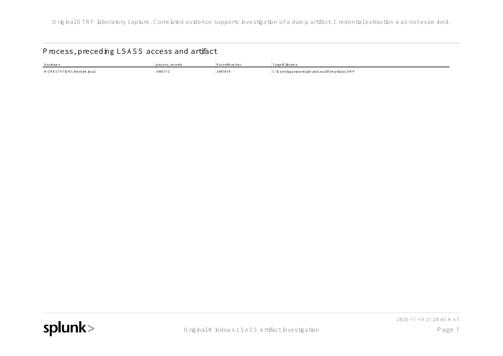
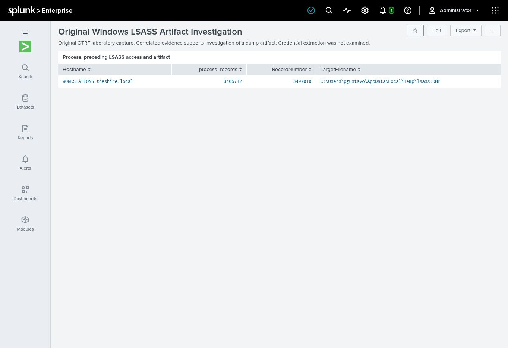

# Blue team investigation lab

A reproducible SOC portfolio project investigating original Windows evidence of LSASS access and dump-artifact creation, validated in Python and Splunk Enterprise 10.6.1.1. A separate synthetic authentication case tests correlation behavior.

## Investigations

| Case | Evidence | Result |
| --- | --- | --- |
| Remote access after repeated failures | Synthetic Windows authentication and endpoint records | Two authentication findings. The high-priority account links to encoded PowerShell and a connection from the same process. Case notes support escalation and training closure decisions. |
| LSASS dump artifact | Original OTRF Windows capture | Task Manager process 3405712 links to six preceding LSASS access records and dump-file record 3407010. Python and Splunk agree. |

The public case supports suspected credential dumping. Artifact contents and credential extraction were not examined.

## Reproduce on Linux

Python 3.12 and its standard library suffice for the offline analyses.

```bash
python3 investigate.py
python3 inspect_public_rdp.py
python3 investigate_public_rdp.py
python3 -m unittest discover -s tests -v
```

Read [the public case study](reports/public-rdp-case.md) and [the synthetic triage record](reports/triage.md). Results preserve event IDs and process GUIDs.

## Splunk evidence

[Executed searches and validation instructions](detections/splunk/README.md) describe ingestion and replay. The supplied validators require a local running Splunk instance and a private password file. Seven synthetic negative cases reject misleading correlation. Four additional negative cases validate the original-evidence rule against wrong artifact process, wrong hostname, artifact timing and missing process creation.

[Original-evidence dashboard PDF export](reports/public-dashboard.pdf)



The PDF was generated by Splunk and visually inspected. Both dashboards were verified in an authenticated Splunk Web session on 15 November 2026. [Watch the live browser recording](demo/live-dashboard.mp4).



## Demonstration

Download and open [the command-output replay](demo/index.html). It contains actual successful command executions. [The recording](demo/recording.json) includes complete output and exit codes. Run python3 demo/record.py to regenerate it.

## Design and validation

The synthetic correlation joins destination host, domain, user and source across authentication events. It maps the successful Security event to a session, then correlates process and connection GUIDs within a fifteen-minute window. Matching context and temporal order prevent unrelated activity from raising priority.

The public case uses original Sysmon UtcTime for ordering. Collector timestamps differ and remain preserved in the source archive. Public Splunk ingestion assigns current ingestion time to avoid retention issues with historical evidence, while searches parse the original time.

27 Python tests pass. Splunk processed 39 synthetic rows and separately 2,018 original Sysmon process/access/file events. Captured validation results and their limitations are in reports/.

## Data and scope

Authentication CSV columns are timestamp, record_id, event_id, computer, domain, user, src_ip and logon_type. Timestamps need offsets. Use one continuous Security capture per host and separate log-reset epochs.

Normalized endpoint JSONL requires id, timestamp, host, session and kind. Logon adds security_record and user. Process adds image, command_line and process_guid. Network adds process_guid and destination. See the bundled fixture for exact examples. Raw EVTX requires conversion.

The OTRF archives retain their MIT license, pinned source commit and SHA256 records. Project implementation was developed with AI assistance and executed on Linux. The supplied cases validate laboratory behavior. Production precision, recall and deployment hardening remain unmeasured.

See [release status and limits](STATUS.md), [research](RESEARCH.md) and [response playbook](PLAYBOOK.md).

[Watch the 40-second evidence walkthrough](demo/walkthrough.mp4). Download the MP4 to play it locally.
